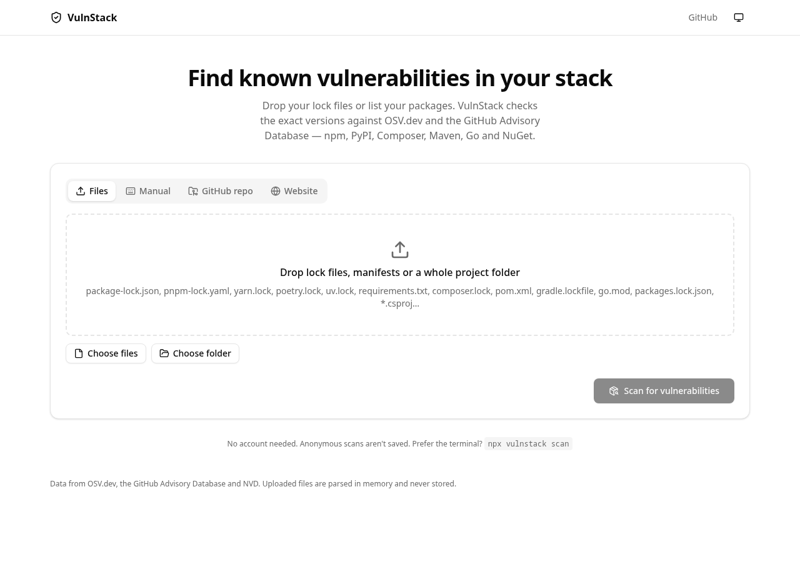
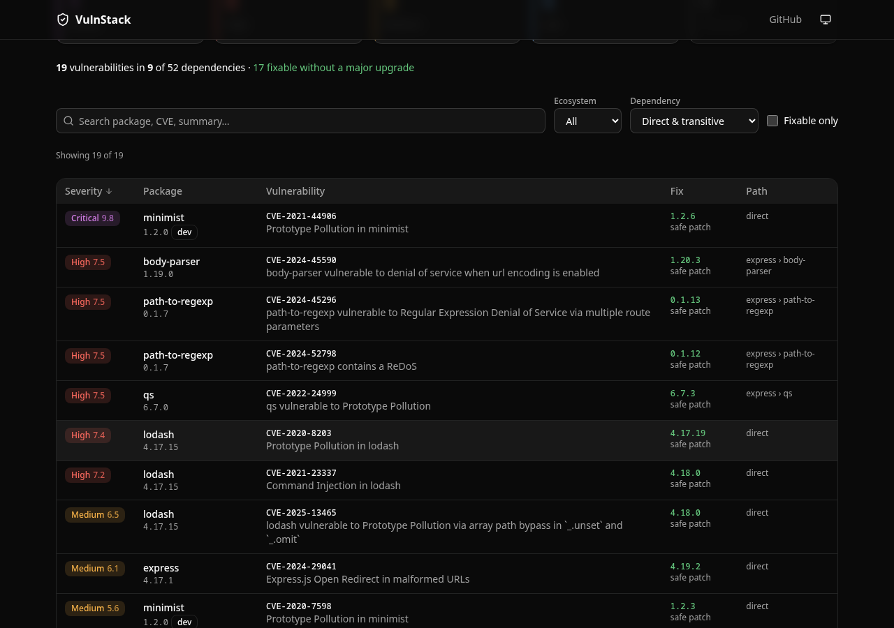
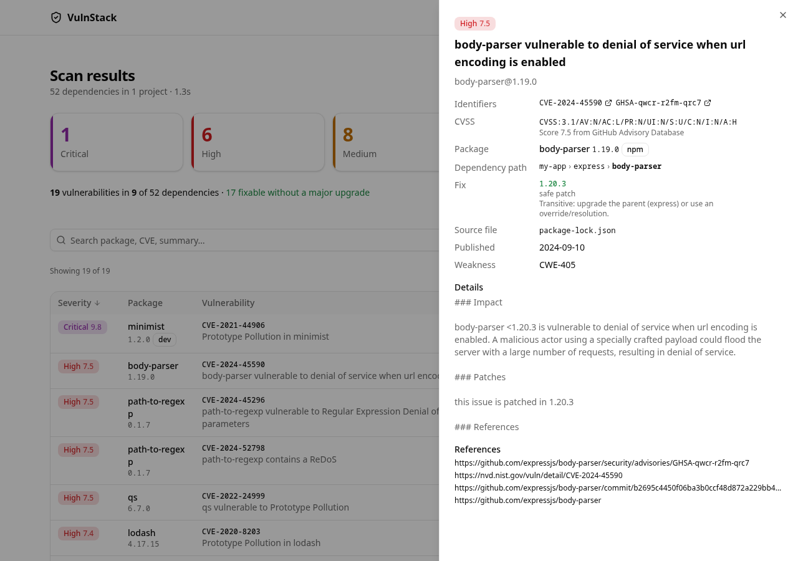
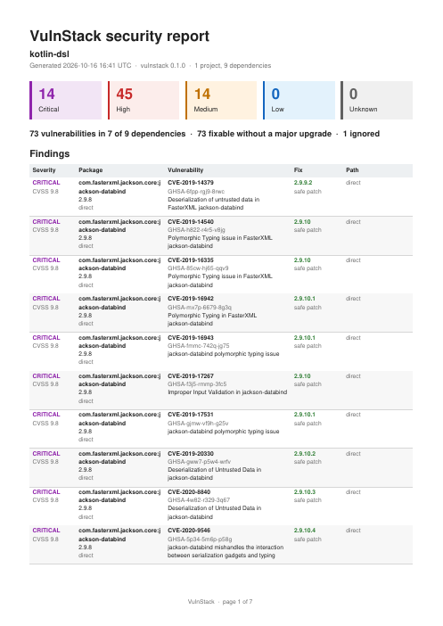
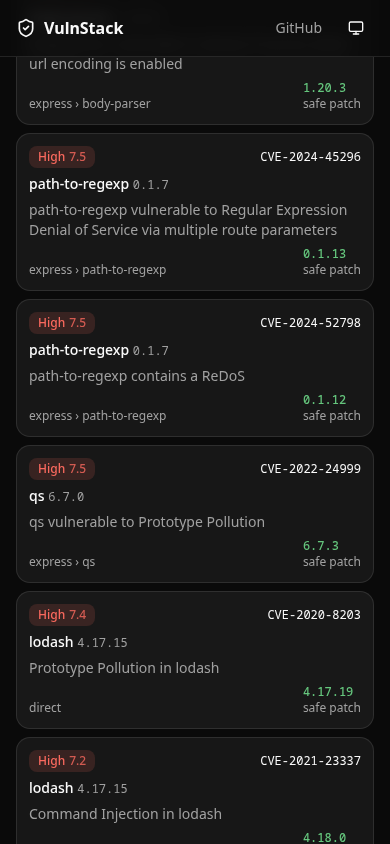
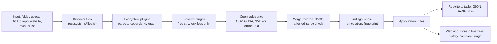

# VulnStack

Find known vulnerabilities (CVE / GHSA) in the exact versions of the dependencies your project uses, with the dependency chain that pulls each one in and the lowest version that fixes it.

VulnStack is an open-source (MIT) CLI and web app. It reads your lock files, asks [OSV.dev](https://osv.dev) (plus the GitHub Advisory Database and NVD when configured) and reports what is affected.



|                                                           |                                                        |
| --------------------------------------------------------- | ------------------------------------------------------ |
|  |  |
|             |           |

## Features

- **Six ecosystems:** npm, PyPI, Packagist (Composer), Maven (incl. Gradle), Go, NuGet. Monorepos are scanned per sub-folder.
- **Lock-file first.** Lock files pin exact versions and list transitive dependencies. Without one, manifest ranges are resolved against the package registry and the result is flagged as _estimated_ (confidence `medium`).
- **Transitive chains.** Every finding shows the shortest path, e.g. `my-app > express > body-parser`.
- **Safe patch vs breaking update.** The lowest fixed version is classified as a safe patch, a breaking (major) update, or no fix available.
- **Several advisory sources.** OSV.dev always; GitHub Advisory Database when a `GITHUB_TOKEN` is set; NVD for CVSS enrichment. Records describing the same issue are merged (`CVE-…` and `GHSA-…`). CVSS precedence is **NVD > GHSA > OSV**.
- **Reports:** table, JSON ([schema](docs/report-schema.json)), SARIF 2.1.0 (GitHub Code Scanning) and PDF. See [docs/report-format.md](docs/report-format.md).
- **CI gate:** `--fail-on <severity>` sets the exit code.
- **Ignore file:** `.vulnstackignore` with reasons and expiry dates. See [docs/ignore-file.md](docs/ignore-file.md).
- **GitHub repositories** (`--repo owner/repo`, no clone) and **passive website scanning** (`--url`, requires explicit consent). See [docs/website-scanning.md](docs/website-scanning.md).
- **Web app:** accounts (GitHub sign-in), scan history, compare two scans, triage (accepted / false positive), personal API tokens for CLI uploads, PDF/SARIF/JSON export.
- **Offline mode:** keep a local copy of the advisory database and scan without network access to OSV (`vulnstack db update`, `vulnstack scan --offline`).

### Supported files

| Ecosystem        | Lock files                                                                | Manifests                                     | Also read                  |
| ---------------- | ------------------------------------------------------------------------- | --------------------------------------------- | -------------------------- |
| npm              | `npm-shrinkwrap.json`, `package-lock.json`, `pnpm-lock.yaml`, `yarn.lock` | `package.json`                                |                            |
| PyPI             | `poetry.lock`, `uv.lock`, `Pipfile.lock`, `requirements*.txt`             | `pyproject.toml`, `Pipfile`                   |                            |
| Packagist        | `composer.lock`                                                           | `composer.json`                               |                            |
| Maven (+ Gradle) | `gradle.lockfile`                                                         | `pom.xml`, `build.gradle`, `build.gradle.kts` | `libs.versions.toml`       |
| Go               | `go.mod` (pins the whole module graph, Go 1.17+)                          |                                               |                            |
| NuGet            | `packages.lock.json`, `packages.config`                                   | `*.csproj`, `*.fsproj`, `*.vbproj`            | `Directory.Packages.props` |

When a lock file is present, manifests next to it are only used as context (for example to mark direct dependencies).

## Quick start

Requires Node.js 22.12 or newer.

```sh
npx vulnstack scan                       # scan the current folder
npx vulnstack scan path/to/project
npx vulnstack scan --manual "react@18.2.0,express@4.17.1"
npx vulnstack scan -f json -o report.json
npx vulnstack scan --repo owner/repo     # GitHub repo, no clone
npx vulnstack scan --url https://example.com --i-own-this-site
```

## CLI usage

### Commands

| Command                 | Purpose                                                   |
| ----------------------- | --------------------------------------------------------- |
| `vulnstack scan [path]` | Scan a folder, `--manual` list, `--repo` or `--url`       |
| `vulnstack db update`   | Download OSV dumps and build the offline database         |
| `vulnstack db status`   | Show what the offline database contains and how old it is |

```text
vulnstack scan [path] [options]
```

`[path]`, `--manual`, `--repo` and `--url` are mutually exclusive. Without any of them the current folder is scanned.

### Options

| Option                        | Description                                                                                                    |
| ----------------------------- | -------------------------------------------------------------------------------------------------------------- |
| `-m, --manual <packages>`     | Scan a list instead of files, e.g. `"react@18.2.0,express@4.17.1"`                                             |
| `--repo <url\|owner/repo>`    | Scan a GitHub repository without cloning (private: set `GITHUB_TOKEN`)                                         |
| `--url <site>`                | Passively fingerprint a site's JavaScript libraries (needs `--i-own-this-site`)                                |
| `--i-own-this-site`           | Confirm you may scan the `--url` site (or set `VULNSTACK_URL_CONSENT=1`)                                       |
| `--retire`                    | With `--url`: also use retire.js signatures (downloaded once a day)                                            |
| `-f, --format <format>`       | `table` (default), `json`, `sarif` or `pdf`                                                                    |
| `-o, --output <file>`         | Write the report to a file instead of stdout (required for `pdf` on a terminal)                                |
| `--fail-on <severity>`        | Exit with code 1 when a finding is at or above `critical`, `high`, `medium`, `low` or `any` (includes unknown) |
| `--ignore <ids>`              | Ignore vulnerabilities by id (CVE/GHSA/…); repeatable or comma separated                                       |
| `--ignore-file <path>`        | Ignore rules file (default: `.vulnstackignore` in the scanned folder; not looked up for `--repo` / `--url`)    |
| `--upload`                    | Upload the JSON report to the web app (needs `VULNSTACK_TOKEN`)                                                |
| `--project <name>`            | Project name for `--upload` (default: folder, repo or host name, or `manual`)                                  |
| `--api-url <url>`             | Web app base URL for `--upload` (default: `$VULNSTACK_API_URL`)                                                |
| `--offline`                   | Scan against the local OSV database (see [Offline mode](#offline-mode)); incompatible with `--url`             |
| `--offline-dir <path>`        | Offline database folder (default: `$XDG_CACHE_HOME/vulnstack/offline`, i.e. `~/.cache/vulnstack/offline`)      |
| `--no-dev`                    | Skip dev dependencies                                                                                          |
| `--no-cache`                  | Do not read or write the local advisory cache (`~/.cache/vulnstack`, 6 h TTL)                                  |
| `--no-resolve`                | Do not query package registries to resolve manifest ranges                                                     |
| `--no-ghsa`                   | Do not query the GitHub Advisory Database even when a token is set                                             |
| `--nvd`                       | Enrich CVSS scores from NVD even without `NVD_API_KEY` (slow: about 5 requests per 30 s)                       |
| `--no-nvd`                    | Do not query NVD even when `NVD_API_KEY` is set                                                                |
| `--nvd-timeout <seconds>`     | Time budget for NVD enrichment (default 10)                                                                    |
| `-v, --version`, `-h, --help` | Print version / help                                                                                           |

### Offline mode

```sh
vulnstack db update [--ecosystem <eco...>] [--dir <path>]
vulnstack db status [--dir <path>]
vulnstack scan --offline [--offline-dir <path>]
```

- `db update` downloads the OSV dump of each ecosystem and builds a local index. Default: all six (npm, PyPI, Packagist, Maven, Go, NuGet). `--ecosystem` is case-insensitive and accepts several values, space or comma separated (`--ecosystem npm go` or `--ecosystem npm,Go`). Requests send `If-None-Match` with the stored ETag, so unchanged dumps are not downloaded again.
- `db status` lists the built time, record count and size per ecosystem and warns when the data is older than 7 days.
- `scan --offline` answers from the local database: no OSV, GHSA or NVD calls and no registry range resolution. Manifest ranges that are not pinned by a lock file are therefore not scanned, so lock files are needed for full coverage. It cannot be combined with `--url`.
- An ecosystem's index is read only when the scan queries it. If a queried ecosystem was never downloaded, a warning names it (once) and suggests `vulnstack db update --ecosystem <eco>`.
- Default folder: `$XDG_CACHE_HOME/vulnstack/offline` (`~/.cache/vulnstack/offline` when `XDG_CACHE_HOME` is unset). Override with `--dir` / `--offline-dir`.
- Size: the npm dump is large (a download of hundreds of MB) and indexing it needs about 1 GB of memory.

### Exit codes

| Code | Meaning                                                                               |
| ---- | ------------------------------------------------------------------------------------- |
| `0`  | Scan finished; no `--fail-on` threshold was hit                                       |
| `1`  | `--fail-on` threshold reached by at least one finding (ignored findings do not count) |
| `2`  | Error: bad arguments, unreadable input, network failure, or `--upload` failed         |

### Environment variables

| Variable                                                   | Purpose                                                                                                          |
| ---------------------------------------------------------- | ---------------------------------------------------------------------------------------------------------------- |
| `GITHUB_TOKEN` (also `GH_TOKEN`, `VULNSTACK_GITHUB_TOKEN`) | Enables GitHub Advisory Database queries (no scopes needed) and `--repo` for private repositories (`repo` scope) |
| `NVD_API_KEY`                                              | Turns on NVD CVSS enrichment with the higher rate limit                                                          |
| `VULNSTACK_TOKEN`                                          | API token for `--upload` (web app: Settings, API tokens)                                                         |
| `VULNSTACK_API_URL`                                        | Web app URL for `--upload`                                                                                       |
| `HTTPS_PROXY` / `NO_PROXY`                                 | Proxy settings for outgoing requests                                                                             |
| `XDG_CACHE_HOME`                                           | Base directory of the advisory cache (default `~/.cache`, then `vulnstack/`)                                     |
| `VULNSTACK_URL_CONSENT`                                    | Set to `1` to confirm website-scan consent without `--i-own-this-site`                                           |
| `NO_COLOR`, `CI`                                           | Colour and progress output follow the usual conventions                                                          |

## CI usage

### GitHub Action

```yaml
name: Dependency vulnerabilities
on:
  push:
    branches: [main]
  pull_request:
  schedule:
    - cron: '0 6 * * 1'

permissions:
  contents: read
  security-events: write # for SARIF upload

jobs:
  vulnstack:
    runs-on: ubuntu-latest
    steps:
      - uses: actions/checkout@v4
      - uses: vulnstack/vulnstack@v1
        with:
          fail-on: high
          github-token: ${{ secrets.GITHUB_TOKEN }}
```

Inputs: `path`, `fail-on`, `format`, `output`, `version`, `github-token`, `nvd-api-key`, `upload-sarif`. See [action.yml](action.yml) and [.github/examples/vulnstack.yml](.github/examples/vulnstack.yml).

### Plain npx

```yaml
- uses: actions/setup-node@v4
  with:
    node-version: 22
- run: npx --yes vulnstack scan --fail-on high
```

### SARIF upload to Code Scanning

```yaml
- run: npx --yes vulnstack scan -f sarif -o vulnstack.sarif --fail-on high
  continue-on-error: true
- uses: github/codeql-action/upload-sarif@v3
  if: always()
  with:
    sarif_file: vulnstack.sarif
```

`continue-on-error` keeps the job going so the upload step still runs; gate the pipeline on the scan step's outcome if you need it to fail.

## Web app and self-hosting

The web app (`apps/web`, Next.js) offers the same scanner in the browser: drag and drop dependency files, scan a GitHub repository or a website, sign in with GitHub to keep history, compare scans, triage findings and create API tokens for `vulnstack scan --upload`.

Self-host with Docker Compose:

```sh
cp .env.example .env     # set BETTER_AUTH_SECRET at least
docker compose up -d --build
```

Full instructions, environment variables, GitHub OAuth setup, reverse proxy and backups: [docs/self-hosting.md](docs/self-hosting.md).

## Architecture

```text
vulnstack/
  apps/
    cli/        vulnstack command (commander, tsup bundle, published to npm)
    web/        Next.js app: UI, REST API, GitHub sign-in (Better Auth)
  packages/
    core/       framework-agnostic scanning engine and reporters
    db/         Drizzle ORM schema, migrations, Postgres / PGlite client
  fixtures/     real and hand-written lock files with known-vulnerable versions (test data)
  docs/         documentation, JSON report schema, screenshots
```



`packages/core` has no framework dependencies and takes an injectable `fetch`, cache and file provider, so the same engine runs in the CLI, the server and tests. New languages are added as ecosystem plugins: [docs/adding-an-ecosystem.md](docs/adding-an-ecosystem.md).

## Privacy and security

- The CLI sends package names and versions (not your source code or file contents) to OSV.dev, and to GitHub / NVD when enabled. Package registries are contacted only to resolve manifest ranges (`--no-resolve` disables this).
- Website scanning is passive and needs explicit consent; it refuses private and internal addresses. See [docs/website-scanning.md](docs/website-scanning.md).
- In the web app, GitHub access tokens are encrypted at rest, API tokens are stored only as SHA-256 hashes, and the `repo` scope is requested only on demand when you scan a private repository.
- Report vulnerabilities in VulnStack itself privately: see [SECURITY.md](SECURITY.md).

## Documentation

- [Self-hosting](docs/self-hosting.md)
- [Report format (JSON, SARIF, PDF)](docs/report-format.md)
- [Ignore file](docs/ignore-file.md)
- [Website scanning](docs/website-scanning.md)
- [Adding an ecosystem](docs/adding-an-ecosystem.md)

## Contributing

Contributions are welcome. Start with [CONTRIBUTING.md](CONTRIBUTING.md); please follow the [Code of Conduct](CODE_OF_CONDUCT.md).

## License

[MIT](LICENSE). The optional retire.js signatures used by `--retire` are licensed under Apache-2.0 and are downloaded at run time, not bundled.
