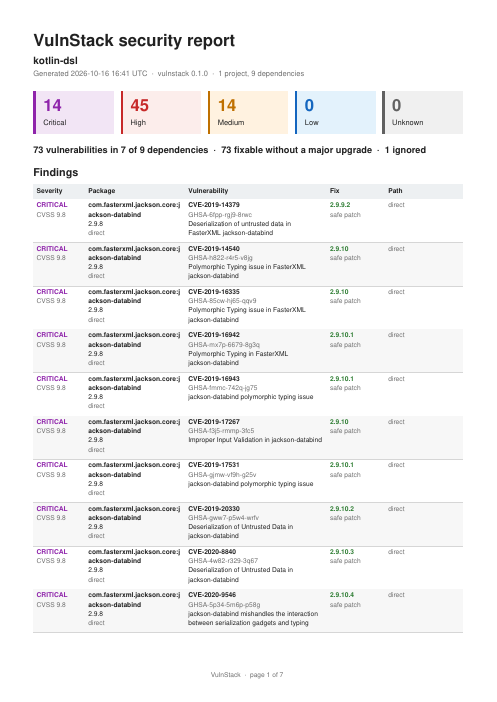

# Report format

`vulnstack scan` can emit four formats: `table` (human), `json`, `sarif` and `pdf`. JSON, SARIF and PDF are all built from the same scan result, so a saved JSON report can later be converted by tools that import `@vulnstack/core`.

## JSON

`vulnstack scan -f json -o report.json`. The formal definition is [report-schema.json](report-schema.json) (JSON Schema 2020-12). `schemaVersion` is `1`; new optional fields may be added without a bump, removals or meaning changes bump it.

### Top-level fields

| Field                     | Description                                                                                                                                                                     |
| ------------------------- | ------------------------------------------------------------------------------------------------------------------------------------------------------------------------------- |
| `schemaVersion`           | Always `1` for now                                                                                                                                                              |
| `tool`                    | `{ name: "vulnstack", version }`                                                                                                                                                |
| `startedAt`, `durationMs` | When the scan started (ISO 8601) and how long it took                                                                                                                           |
| `subprojects`             | One entry per scanned unit (folder + ecosystem): `path`, `ecosystem`, `root`, flat `dependencies[]`, `warnings[]`. `path` is `''` for the scan root and `manual` for `--manual` |
| `findings`                | Vulnerabilities in dependencies, sorted by severity, then CVSS score, then direct before transitive                                                                             |
| `ignored`                 | Findings suppressed by `--ignore` or [`.vulnstackignore`](ignore-file.md), each with the matching `rule` (`id`, `package`, `until`, `reason`, `source`)                         |
| `summary`                 | `subprojects`, `dependencies`, `vulnerableDependencies`, `findings` and `bySeverity` counts (ignored findings are excluded)                                                     |
| `warnings`                | Non-fatal problems. Each has a stable `code`, a `message` and optionally a `file`                                                                                               |
| `detected`                | Website scans only: technologies fingerprinted from the site (informational)                                                                                                    |

### Finding

| Field           | Description                                                                                                                                          |
| --------------- | ---------------------------------------------------------------------------------------------------------------------------------------------------- |
| `fingerprint`   | Stable identity of a finding across scans (below)                                                                                                    |
| `subproject`    | Folder of the sub-project                                                                                                                            |
| `dependency`    | `ecosystem`, `name`, `version`, `isDirect`, `sourceFile`, `confidence`, optional `declaredRange` and `scope`                                         |
| `chain`         | Shortest path from the project, e.g. `["my-app", "express", "body-parser"]`                                                                          |
| `pathCount`     | Number of distinct paths that pull the dependency in (capped)                                                                                        |
| `vulnerability` | `id` (CVE preferred, then GHSA, then others), `aliases`, `summary`, `details`, `severity`, `cvss`, dates, `references`, OSV-style `affected`, `cwes` |
| `remediation`   | `type` and, when known, `fixedVersion`                                                                                                               |

### Fingerprint semantics

`fingerprint` is `subproject|ecosystem|package|vulnerability-id`, for example `.|npm|body-parser|CVE-2024-45590` (an empty sub-project is written `.`). It deliberately **excludes the version**: upgrading from one vulnerable version to another keeps the same fingerprint, so the web app can keep triage decisions, compare scans (new / fixed / unchanged) and SARIF consumers can track an alert over time. It changes when the package, the sub-project or the preferred vulnerability id changes.

### Confidence levels

`dependency.confidence` says how sure VulnStack is that `version` is what actually runs.

| Level    | Meaning                                                                        |
| -------- | ------------------------------------------------------------------------------ |
| `high`   | Pinned by a lock file, or given explicitly (`--manual`)                        |
| `medium` | Resolved from a manifest range, or detected from a website asset URL or header |
| `low`    | Guessed, for example an unresolvable range or a weak website signature         |

Manifest-only scans also produce a `no-lockfile` warning.

### Remediation types

| `remediation.type` | Meaning                                                                                   |
| ------------------ | ----------------------------------------------------------------------------------------- |
| `safe-patch`       | `fixedVersion` is the lowest unaffected version and is not a major bump for the ecosystem |
| `breaking-update`  | The lowest fix requires a major (breaking) upgrade, per the ecosystem's versioning rules  |
| `no-fix`           | No fixed version is known                                                                 |

### CVSS and severity

`vulnerability.cvss` has `score`, `vector`, `version` (3.0, 3.1 or 4.0) and `source`. When several sources score the same issue the precedence is **NVD > GHSA > OSV**. `severity` is derived from the score (or from the advisory when no score exists); `unknown` is used when neither is available.

### Detected technologies and ignored findings

`detected` lists `{ name, version?, source, confidence }` where `source` is an asset URL, `headers` or `meta`. A detected library that also matches an advisory appears again in `findings`; everything else is informational. `ignored` keeps suppressed findings in the report so audits can see what was waived and why.

## SARIF

`vulnstack scan -f sarif -o vulnstack.sarif` writes SARIF 2.1.0, accepted by GitHub Code Scanning (`github/codeql-action/upload-sarif`).

| SARIF element                  | Content                                                                                                                                 |
| ------------------------------ | --------------------------------------------------------------------------------------------------------------------------------------- |
| `tool.driver.rules[]`          | One rule per distinct vulnerability id, with summary, details, help (Markdown), `helpUri` and aliases                                   |
| `properties.security-severity` | CVSS score as a string with one decimal; without a score a severity fallback (critical 9.5, high 8.0, medium 5.5, low 2.0, unknown 5.0) |
| `level`                        | `critical`, `high` map to `error`; `medium` and `unknown` to `warning`; `low` to `note`                                                 |
| `results[]`                    | One result per finding with `ruleId`, a message that includes the chain and the fix, and the dependency file as location (line 1)       |
| `partialFingerprints`          | `vulnstackFinding` = the finding `fingerprint`                                                                                          |
| `result.properties`            | `ecosystem`, `package`, `version`, `direct`, `chain`, `fixType`, `fixedVersion`, `confidence`                                           |
| `suppressions`                 | Ignored findings are included as results with an `external` / `accepted` suppression whose justification is the rule's reason           |
| `invocations`                  | Scan start time and warnings as tool execution notifications                                                                            |

## PDF

`vulnstack scan -f pdf -o report.pdf` produces a shareable document with:

- a header with the project name, generation time (UTC), tool version and counts of projects and dependencies;
- severity tiles and a one-line summary (findings, vulnerable dependencies, how many are fixable without a major upgrade, how many are ignored);
- a findings table with severity, package and version, vulnerability id and summary, fix, and dependency path;
- an **Ignored** section (id, package, reason, rule source and expiry) and a **Notes** section with the scan warnings;
- page footers with page numbers.

PDF is binary, so write it to a file (or redirect stdout). The web app offers the same PDF, SARIF and JSON exports for stored scans.

